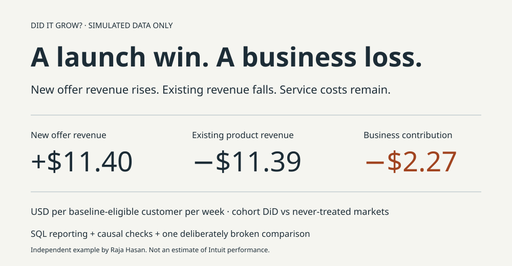

# Did it grow?

A launch review that counts revenue lost from the existing product, the new offer's revenue, and the cost of serving it.

[Open the report](https://rhasan55.github.io/did-it-grow/) · [SQL](panel.sql) · [Analysis](analysis.py)



In this case, nearly all the new-offer revenue replaces existing-product revenue. Added service costs make the combined contribution negative. A report covering only the new offer would miss that.

All observations are simulated. This is not an estimate of Intuit's results. The question came from its public consumer-product launches and a role focused on measuring a program that cannot be randomized. [Context](sources.md)

## What changes the answer

The report has three cases with the same rollout dates and customer denominator:

| Case | Contribution estimate | Interpretation |
| --- | ---: | --- |
| Revenue shift | −$2.27 | The new offer gains what the existing product loses, then incurs service cost. |
| Added value | +$5.71 | The new offer covers displaced revenue and service cost. |
| Bad comparison | +$8.63 | Rollout markets were already growing faster. Do not use this estimate to decide. |

Amounts are USD per baseline-eligible customer per week, averaged over eight weeks. These examples are constructed to expose different measurement failures; they are not evidence of real-world estimator accuracy.

## Reproduce

```bash
python -m venv .venv
source .venv/bin/activate
pip install -r requirements.txt
python analysis.py
python -m unittest -v test_analysis.py
```

Python 3.12; dependencies are pinned. Seed 55 reproduces the displayed values. Use `python analysis.py --seed 123` for another draw. You can also open `index.html` directly without installing anything.

`panel.sql` resolves order versions and refunds before building a zero-filled market-week panel. The analysis compares each rollout cohort with never-treated markets. Synthetic-control weights are fit before launch, with four weeks held out. Whole markets are resampled for the DiD interval.

This is a small local example, not a warehouse performance benchmark or a full implementation of a published estimator. Unobserved shocks at rollout can invalidate both methods even if pre-launch checks pass.

[Methods](methods.md) · [Checks and development notes](analysis-audit.md) · [Test output](test-results.txt)
